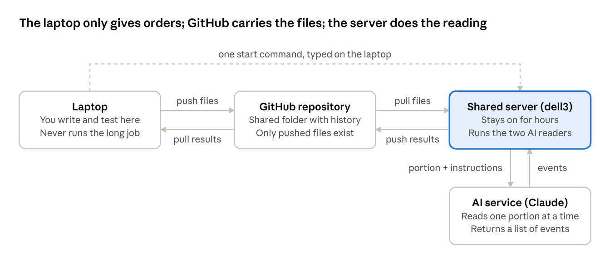

# How we built the decree spreadsheet with AI agents

Nov 12, 2026 · @Matias Delgadino

## The task

Turn a 1,248-page PDF of Argentine secret decrees (1976–1983) into one spreadsheet with a row per person and the dates and decree numbers of what happened to them. The instruction, as given:

> Crear un Excel donde cada persona que aparezca en conexión con el "derecho de opción" sea una fila que registre: (1) cuándo y bajo qué decreto fue arrestada a disposición del Poder Ejecutivo Nacional; (2) cuándo y bajo qué decreto le fue denegado el derecho de opción a salir del país, a menudo en reiteradas ocasiones; (3) cuándo y bajo qué decreto fue diferida la solicitud; (4) cuándo y bajo qué decreto fue puesta bajo libertad vigilada; (5) cuándo y bajo qué decreto fue liberada; (6) cuándo y bajo qué decreto le fue autorizada la salida del país y con qué destino.

The added requirement was to run the work on the department's shared computer, slowly and reliably, with two AI readers checking each other, and not on the laptop.

The result is a file called `opcion.xlsx` with four sheets:

| Sheet | What it holds |
| --- | --- |
| Personas | One row per person: name, ID document, then two columns (decrees, dates) for each of the six events, plus destination and place of supervised release where stated |
| Solo arresto | People who so far appear only in an arrest decree |
| Eventos | Every single event found, one per row, with the PDF page it came from |
| Resumen | Counts |

A second file, `revisar.xlsx`, lists the cases where the two AI readers disagreed, for a human to settle.

## The approach: small portions, two readers, compare

You cannot paste a 1,248-page PDF into a chat window and ask for a spreadsheet. The AI would run out of room, skip names, and you would have no way to know what it skipped. So the work was arranged like a transcription project in an archive.

1. **Cut the book into cards.** A small program read the PDF and cut it at the markers that separate one decree from the next: 7,039 decrees, each saved as its own text file with its number, date and PDF page on top. Decrees about appointments, military postings or firearms were set aside; 3,360 about arrests, releases and the option to leave the country remained.
2. **Bundle the cards into portions of 25.** That is 135 portions. Each is small enough for the AI to read every name carefully in two or three minutes.
3. **Give every portion to two readers who never talk to each other.** Both are the same AI, but each works from a differently worded instruction sheet and has no memory of the other. Each returns a list of events: person, ID document, type of event, decree, date, destination, page.
4. **Compare the two lists.** An event both readers found is accepted. An event only one found, or where they wrote the ID differently, goes to `revisar.xlsx` for a person to check against the PDF page.
5. **Group events by person** into the final spreadsheet, using the ID number when there is one and the name otherwise.

The value of two readers is not that two are smarter than one. It is that their mistakes are different, so a disagreement points at exactly the line worth checking. In the pilot, 50 decrees gave 752 events from each reader and they agreed on 751. The one disagreement was a name split across a line break in the PDF: one reader wrote Erminio CORIA, the other Erminido CORIA.

## Three places, and GitHub as the messenger

The work happens in three places, and only one of them does the heavy reading.

- **The laptop.** Where you write and test the instruction sheets and the small programs, look at results, and type the commands that start things elsewhere. It never runs the long job: closing the lid or losing wifi would kill it.
- **The shared server ("dell3").** A large computer in the department that stays on. You reach it by typing one command on the laptop, after which what you type runs there. It does the hours of AI reading.
- **The GitHub repository.** Think of it as a shared folder with a complete history. Every change is a dated, named snapshot. The laptop pushes its snapshot up, the server pulls it down, works, and pushes its own results up, and the laptop pulls those back.

Files always travel through GitHub; only the one start command goes from the laptop straight to the server, and only the server talks to the AI service.

The one rule: the server only ever sees what has been pushed to GitHub. If you edit a file on the laptop and forget to push, the server runs the old version. Conversely, results that exist only on the server are invisible until it pushes. The scripts we wrote push progress every ten finished portions, so a crash loses little and you can follow along from the laptop.

A GitHub repository must be created once by hand on the GitHub website (a private one, named here `decretos-opcion`). It then has an address that both the laptop and the server use. The PDF itself, 37 MB, is stored in it too, so everything the job needs travels together.

## What a headless agent is and how we set one up

A headless agent is the same AI you talk to in a chat window, but with the window removed. You hand it a written instruction and a text to read, it answers once, and it stops. Nobody watches, nobody types follow-ups. Because nobody is there, everything the AI needs to know has to be on the page it receives, and a program has to feed it the next portion and keep the answers.

We set it up with four pieces, all plain text files kept in the repository:

1. **An instruction sheet** (`prompts/extract.md`). It explains, in Spanish, what counts as each of the six events, gives the exact phrases the decrees use ("Arréstese a disposición…", "Déjase sin efecto el arresto…", "Difiérese…"), shows one example answer in the fixed format, and tells the AI not to use any tools and to answer with the list only. A second sheet (`prompts/verify.md`) asks for the same thing in different words, for the second reader.
2. **A feeder** (`scripts/run_agents.sh`). A short program that, for each portion, pastes the instruction sheet and the portion together, hands them to the AI, saves the answer in a file named after the portion, and moves on. It runs three portions at a time.
3. **Rules for when things go wrong.** If the answer is not in the expected format, ask again. If the AI service says it is busy or the usage allowance is used up, wait ten minutes and retry. Before starting a portion, check whether its answer file already exists and is well formed; if so, skip it. This last rule is what makes the job restartable: after a crash, a reboot or a deliberate stop, running the same command again finishes only what is missing.
4. **A starter command**, typed once from the laptop. It tells the server to open a session that survives disconnection, pull the latest snapshot from GitHub, run the feeder over all portions, then the comparison, write a log, and push the results.

The instruction sheet is where the quality is decided. We wrote it after reading about ten decrees of each kind in the PDF, so the phrases in it are the ones the documents actually use. Then we ran a **pilot**: two portions, 50 decrees, read by both readers, checked by hand against the PDF, before launching the full run. A flaw in the instruction found during the pilot costs ten minutes; found after the full run, it costs the whole four hours.

## Pitfalls we fell into, and how we got out

| What went wrong | How we noticed | How we got out |
| --- | --- | --- |
| The page has four columns and a running header. Read naively, lines from different columns interleave and header fragments like "Primera Secció" land inside decrees. | Printed a few decrees and read them. | Cut each page into its four column strips first, start reading below the header, and drop any leftover header fragments. |
| The filter that picks relevant decrees missed a genuine arrest decree because the scanned text had double spaces ("Poder  Ejecutivo"). | Sampled the decrees marked *not relevant* and found one that began "Arréstese a disposición…". | Squeeze all spacing and remove accents before matching words, and match word stems ("arrest") rather than whole words. |
| Some decrees have a number but no year ("Decreto S 2803"), and three are printed corrections ("Fe de erratas") with no date. | Counted decrees whose number or date came out empty. | Take the year from the decree's date when the number lacks one; told the readers how to treat a correction notice. |
| The AI refused to work on the server: "Not logged in". A switch meant to make it start faster also made it ignore its saved login. | The very first test portion failed in one second. | Removed that switch. Lesson: test one portion end to end before the full run. |
| The retry rules mistook a normal answer for a "usage limit" message because the word *usage* appears in the AI's technical reply, and would have waited ten minutes for nothing. | Same first test. | Look for the phrase in the AI's actual message, not in the whole reply. |
| Installing the two small helper programs on the server was refused: the server protects its system copy of Python. | The install command printed an error. | Install them for the user only, with the flag the error message itself suggests. |
| The same decree number appears twice with different dates. Decree 984/1976 exists from 15 March 1976 and again from 21 June 1976: numbering restarted after the coup. 98 numbers repeat. | A check comparing names per decree against the text gave wrong counts for some decrees. | Keep the date next to every decree number in the spreadsheet, and never identify a decree by number alone. |
| The two readers wrote ID documents differently ("LE 7.936.542" vs "L.E. nº 7.936.542") and these were flagged as disagreements. | The review file filled with trivial items. | Compare IDs by digits and letters only, ignoring dots and "nº". Real disagreements dropped to one in 752. |
| The server's AI login expires a few days after setup. | A warning line in the test output. | Start the full run early; renew the login on the server before it lapses. |

## The numbers

| Item | Value |
| --- | --- |
| PDF | 1,248 pages, 37 MB |
| Decrees found | 7,039 |
| Decrees kept as relevant | 3,360, in 135 portions of 25 |
| Cutting the PDF into decrees | about 1 minute |
| One portion, one reader | 2 to 3 minutes, 300 to 450 events |
| Pilot (2 portions, both readers) | 7 minutes; 752 events each, 751 in agreement |
| Full run (135 portions, both readers, 3 at a time) | started 12 Nov 2026 11:19; expected 4 to 6 hours |
| Human time before the full run | about 3 hours of building and testing, plus the pilot review |

The first 50 decrees are from mid-1976 and contain only arrests, releases and expulsions of foreigners. The denied and deferred requests to leave the country and the supervised releases begin in 1977, so those columns fill in later portions.

## Checklist to do this again with another document

- [ ] Read ten pages of the source by eye. Note how entries are separated and the exact phrases that mark each kind of event.
- [ ] Write a small program that cuts the source into one file per entry and keeps the page number. Check ten of its files against the original.
- [ ] Write the instruction sheet in the language of the source, with the phrases you noted and one example answer in a fixed format. Write a second sheet in different words.
- [ ] Create a private GitHub repository. Put the source, the programs and the instruction sheets in it. Push.
- [ ] On the server: pull the repository, install the two helper programs, and run one portion by hand. Read the answer. Fix whatever broke.
- [ ] Run a pilot of two portions with both readers. Check the result against the source by hand. Fix the instruction sheet, push, repeat if needed.
- [ ] Start the full run in a session that survives disconnection. Follow it from the laptop by reading the log. Do not start a second copy on the same repository.
- [ ] When the log says finished, pull on the laptop, open the spreadsheet, and work through the review file.
